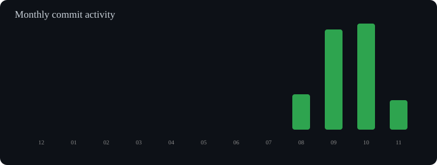

  

Discord but with a little more Linux

  
   
  
   
  
  
  
  

## Setup

1. `npm install`
2. Copy `.env.example` to `.env` and fill in `DISCORD_TOKEN` (from the [Discord Developer Portal](https://discord.com/developers/applications)). Add `GUILD_ID` too if you want `/startup` to appear in your server immediately.
3. In the Developer Portal's OAuth2 URL Generator: check `bot` + `applications.commands`, and under bot permissions check `Send Messages`, `Embed Links`, `Attach Files`. Use the generated link to invite the bot.
4. `npm start`

No privileged intents needed — the bot only requests `Guilds`.

## What's here

- `/startup` — guild-only command that posts the Linuxo status panel (Discord Components V2). Uptime and latency refresh every 5s for 45s using an unref'd timer (automatically cancelled on panel delete, guild removal, or bot shutdown), then freeze.
  - Displays the bundled local `Assets/linuxo-text-logo.png` by default (configurable via `STARTUP_BANNER_URL`, with automatic fallback to a media-free panel if unavailable).
  - Latency is `client.ws.ping`, which only updates on Discord's heartbeat ack (~every 30–40s), so it can repeat across a couple of refreshes — that's expected.
  - The "Ctrl + C" button deletes the panel message with fail-closed authorization: only the verified original `/startup` invoker in the same guild can delete it; anyone else (or a message with missing interaction metadata) receives an ephemeral `Oops, Error 404` reply.
- Rich presence set to "Listening to ls" on boot.
- Slash commands auto-register on startup — to your `GUILD_ID` if set, globally otherwise.
- A structured Components V2 logging/telemetry system (`src/lib/forensic-logger/`) instrumenting every command and button automatically — see below.

## Logging & telemetry

Every slash command and button click is wrapped automatically — you don't need to touch `src/commands/*.js` to get this. It logs to the console always, and optionally to Discord webhooks (as Components V2 containers) and/or a local JSON log file (flushed and closed cleanly on shutdown).

**Setup:** fill in whichever `LOG_WEBHOOK_*` URLs you want in `.env` (create them under a channel's Settings → Integrations → Webhooks). None are required — with all blank, you still get full console + JSON telemetry.

**What you get, with zero code changes:**
- `COMMAND_START` / `COMMAND_END` / `COMMAND_ERROR` for every slash command, with duration, guild/user metadata, and (on failure) a normalized error — printed as a report box in dev console, JSON lines to a file, and optionally shipped to Discord webhooks.
- The same for buttons (`BUTTON_START` / `BUTTON_END` / `BUTTON_ERROR`), with safe ephemeral error feedback on failures.
- A startup diagnostics report and a shutdown report (on `SIGINT` / `SIGTERM`) with command counts, success/failure totals, p50/p95/p99 latency stats, and accurate post-cleanup shutdown timing.
- Automatic boundary-aware redaction of credentials, Discord user/guild/channel identifiers, email addresses, IPv4 addresses, and explicitly marked personal-data fields before records reach console, files, or webhooks.
- Discord webhook log messages are indexed by message ID and automatically deleted after 14 days (hourly cleanup); the index stores no webhook URLs or log contents. Configure `LOG_RETENTION_DAYS` / `LOG_RETENTION_ENABLED` to change or disable this.
- `LOG_FILE` is an optional host-local append-only sink. Its retention is controlled by the host/operator and must be configured separately; webhook retention does not erase copies retained by Discord, container providers, backups, or external log collectors.
- Slow-command detection, guild-isolated error deduplication (suppresses duplicate noise on Discord without cross-guild suppression or dropping console/JSON records), transient-only webhook retry with backoff/rate-limit handling and a circuit breaker, instance-scoped context fields, and bounded memory structures throughout.

**Extension points, for when this bot grows:**
- `logger.registerHealthCheck(name, async () => ({ ok, detail }))` — wire up a database/cache/external-service check; it shows up in the startup report automatically.
- `logger.task({ event, errorEvent, context, handler })` — the same wrapping pattern as commands, for future DB queries or external API calls (`Events.DATABASE_QUERY` / `DATABASE_ERROR`, `EXTERNAL_API_REQUEST`, etc.).
- Inside a command handler, `interaction.client.logger.contextFor(interaction)` returns the live context object for that call — set `.metrics.apiCalls` / `.metrics.cache` on it to have those numbers appear in logs and diagnostics.
- Message/member events (`MESSAGE_CREATE`, `MEMBER_JOIN`, etc.) are defined in the event taxonomy (`src/lib/forensic-logger/core/eventNames.js`) for future use if privileged intents are enabled later.

Run `npm test` to execute the automated test suite.
